# Informe técnico EP2 — Clasificación de enfermedades en hojas de tomate con una CNN

**Asignatura:** TLY1102 — Técnicas Avanzadas de Machine Learning I
**Evaluación:** Parcial N°2 — Presentación y defensa técnica del proyecto
**Notebook:** [`notebooks/plantvillage_cnn.ipynb`](notebooks/plantvillage_cnn.ipynb)
**Trabajo anterior (EP1):** [`informe_tecnico.md`](informe_tecnico.md) y [`notebooks/plantvillage_mlp.ipynb`](notebooks/plantvillage_mlp.ipynb)

En este informe resumimos cómo resolvimos con una red convolucional el mismo
problema de la EP1, qué decisiones tomamos y qué resultados obtuvimos. Seguimos
CRISP-DM igual que en la evaluación anterior. El detalle del código, los gráficos
y las salidas están en el notebook, que dejamos ejecutado completo.

En resumen: con las mismas imágenes, la misma partición y el mismo protocolo de
entrenamiento, la CNN llegó a un 91,00 % de accuracy frente al 82,33 % del MLP,
usando un tercio de los parámetros. La diferencia es estadísticamente
significativa (prueba de McNemar, p = 0,0002) y se cumplen los seis KPIs que
definimos.

---

## 1. Problema de negocio

El tomate es un cultivo de alto valor y, al mismo tiempo, muy expuesto a
enfermedades de la hoja. Hoy el diagnóstico depende de que un agrónomo revise
las plantas a ojo, lo que toma tiempo, no escala bien cuando hay muchas hectáreas
y depende bastante de la experiencia de quien revisa. Si una enfermedad como el
tizón tardío se detecta tarde, puede acabar con un cultivo en pocos días.

La idea del proyecto es que una foto de la hoja sirva para reconocer la
enfermedad. Con eso, el productor podría decidir qué sectores revisar primero y
tratar solo donde hace falta, en vez de fumigar todo el campo por si acaso.

Planteado como problema de machine learning: dada la imagen de una hoja de
tomate, clasificarla en una de cinco clases, una sana y cuatro enfermedades.

| Clase | Tipo | Cómo se ve |
|---|---|---|
| `Tomato_healthy` | Sana | Hoja verde pareja, sin lesiones |
| `Tomato_Early_blight` | Hongo | Manchas con anillos concéntricos, tipo diana |
| `Tomato_Late_blight` | Hongo | Lesiones café irregulares con un halo más claro |
| `Tomato_Leaf_Mold` | Hongo | Manchas amarillas difusas en la cara superior |
| `Tomato_Bacterial_spot` | Bacteria | Muchos puntos pequeños y oscuros |

### 1.1 Qué mantuvimos de la EP1

En la EP1 entrenamos un perceptrón multicapa (MLP) que llegó a 82,33 % de
accuracy. La principal conclusión de ese trabajo fue que el límite del MLP venía
de la arquitectura: al aplanar la imagen con `Flatten()` se pierde la relación
entre píxeles vecinos, y por más neuronas que agregáramos el resultado no
mejoraba. En esta evaluación quisimos comprobar esa idea con una arquitectura
que sí conserva la estructura espacial de la imagen.

Para que la comparación fuera justa, mantuvimos la misma variante del problema:

| Decisión | Valor | Por qué |
|---|---|---|
| Clases | 5 de tomate (1 sana y 4 enfermedades) | Trabajar con una sola especie obliga al modelo a distinguir enfermedades y no especies. Incluimos a propósito un par difícil: los dos tizones. |
| Imágenes por clase | 400 (2.000 en total) | Clases balanceadas y un tamaño que se entrena en pocos minutos. |
| Semilla | 1102 | Para que el muestreo, la partición y la inicialización sean reproducibles. |
| Partición | 70 / 15 / 15 estratificada (1.400 / 300 / 300) | Validación para decidir cuándo parar y qué configuración usar; prueba solo al final. |
| Resolución | 64 × 64 × 3 | La misma que usó el MLP. |

No volvimos a muestrear las imágenes. El notebook lee la partición exacta que
guardamos en la EP1 (`models/particion_*.csv`) y lo comprueba recargando el modelo
del MLP, que da exactamente el mismo 82,33 % sobre la misma prueba. Así nos
aseguramos de que las diferencias entre ambos modelos vengan de la arquitectura y
no de haber usado otras imágenes.

## 2. Objetivos

El objetivo general es diseñar, entrenar y evaluar una red neuronal convolucional
para el problema de la EP1, compararla con el MLP usando evidencia y entender qué
aprende la red a través de los feature maps y de Grad-CAM.

Los objetivos específicos fueron:

1. Preparar las imágenes como tensores para la CNN, reutilizando la partición de la EP1.
2. Diseñar la arquitectura y justificar las capas convolucionales, el pooling, las capas densas y los hiperparámetros.
3. Entrenar el modelo registrando su aprendizaje y revisando si hay sobreajuste.
4. Evaluarlo con accuracy, precision, recall, F1 y matriz de confusión.
5. Compararlo con el MLP en desempeño, parámetros, tiempo, generalización y tipo de errores.
6. Interpretar los feature maps y los mapas de activación de cada clase.
7. Analizar los errores y proponer mejoras.

## 3. KPIs

Mantuvimos los mínimos de la EP1 y agregamos metas que comparan directamente con
el MLP, ya que la idea de esta evaluación es mejorarlo.

| KPI | Meta | Resultado CNN | ¿Cumple? |
|---|---|---|---|
| Accuracy en prueba | Mayor que la del MLP (0,8233) | 0,9100 | Sí |
| F1-score macro | Mayor que el del MLP (0,8192) | 0,9105 | Sí |
| Recall de las clases enfermas | Igual o mayor que el del MLP (0,7792) | 0,8875 | Sí |
| Hojas enfermas clasificadas como sanas (de 240) | Igual o menos que el MLP (6) | 1 | Sí |
| Brecha de generalización (accuracy de entrenamiento − accuracy de prueba) | 0,15 o menos | 0,0614 | Sí |
| Mínimos de la EP1 (accuracy, F1 y recall de enfermas) | 0,60 o más | 0,8875 (el más bajo de los tres) | Sí |

El recall de las enfermas lo medimos por separado porque no todos los errores
cuestan lo mismo. Si una hoja enferma se clasifica como sana, la planta queda sin
tratamiento y sigue contagiando. En cambio, si una sana se marca como enferma, lo
peor que pasa es que alguien la revise.

## 4. Fuentes de datos

Usamos PlantVillage, de Kaggle
([`emmarex/plantdisease`](https://www.kaggle.com/datasets/emmarex/plantdisease)),
que es uno de los datasets autorizados en la pauta. El archivo trae 20.639
imágenes de 15 clases de pimiento, papa y tomate, todas en JPG RGB de 256 × 256
px, con la etiqueta dada por el nombre de la carpeta. El zip viene con el
contenido duplicado en dos carpetas (`PlantVillage/` y `plantvillage/PlantVillage/`).
El notebook lo considera y extrae solo las cinco clases que usamos.

De esas cinco clases había bastantes más imágenes de las que necesitábamos
(Bacterial_spot 2.127, Early_blight 1.000, Late_blight 1.909, Leaf_Mold 952 y
healthy 1.591), así que tomamos 400 de cada una.

Además usamos los resultados de la EP1, que están en `models/`: la partición, las
métricas, la matriz de confusión, el historial de entrenamiento, las
predicciones y el modelo `mlp_plantvillage.keras`. Son nuestra línea base.

## 5. Análisis exploratorio y preparación de los datos

### 5.1 Lo que encontramos en el EDA

- Las cinco clases quedaron con 400 imágenes cada una (280 para entrenamiento,
  60 para validación y 60 para prueba). Al estar balanceadas, el accuracy es una
  métrica confiable y la línea base al azar es 20 %. No fue necesario ponderar clases.
- No encontramos imágenes corruptas. Todas son RGB de 256 × 256, así que no hubo
  que descartar ni corregir nada.
- No hay rutas repetidas ni imágenes compartidas entre entrenamiento, validación
  y prueba (lo verificamos con un `assert`).
- El color promedio ayuda a separar algunas clases. Bacterial_spot es la más
  oscura y Leaf_Mold tiene más azul que el resto. Early_blight y Late_blight, en
  cambio, tienen colores casi iguales: lo que las diferencia es la forma de la
  lesión. Ese tipo de patrón es justamente el que una convolución puede detectar
  y un MLP no.

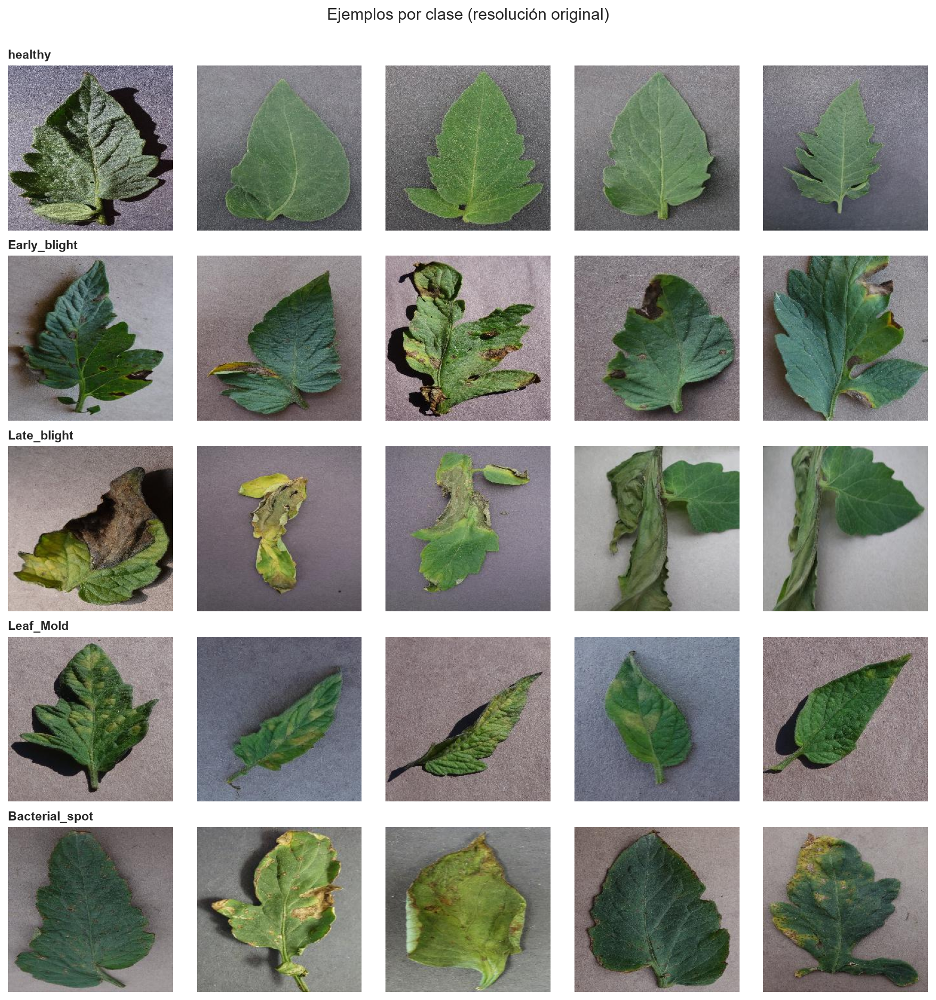
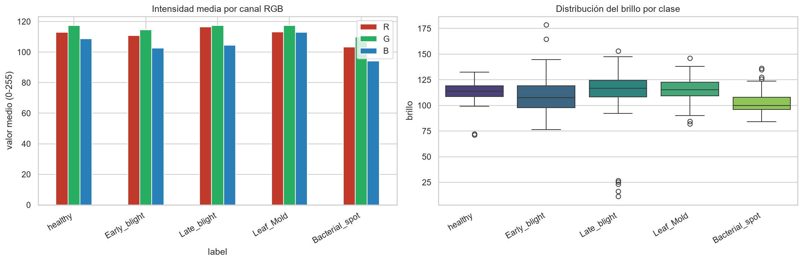

Más adelante nos dimos cuenta de que buena parte del azul de Leaf_Mold no viene
de la hoja sino del fondo de las fotos. Lo explicamos en la sección 11.

### 5.2 Cómo preparamos las imágenes para la CNN

Casi todo el preprocesamiento es igual al de la EP1. Redimensionamos a 64 × 64
con interpolación bilineal, dividimos por 255 para dejar los valores entre 0 y 1
(y verificamos que no quedaran NaN), y usamos el mismo aumento de datos: espejo
horizontal y rotación de hasta ±18°. El aumento lo pusimos como capas del modelo,
para que solo actúe durante el entrenamiento.

El único cambio importante es que esta vez no aplanamos la imagen. El MLP recibía
un vector de 12.288 valores; la CNN recibe el tensor de 64 × 64 × 3 tal como es,
porque necesita saber qué píxeles están al lado de cuáles.

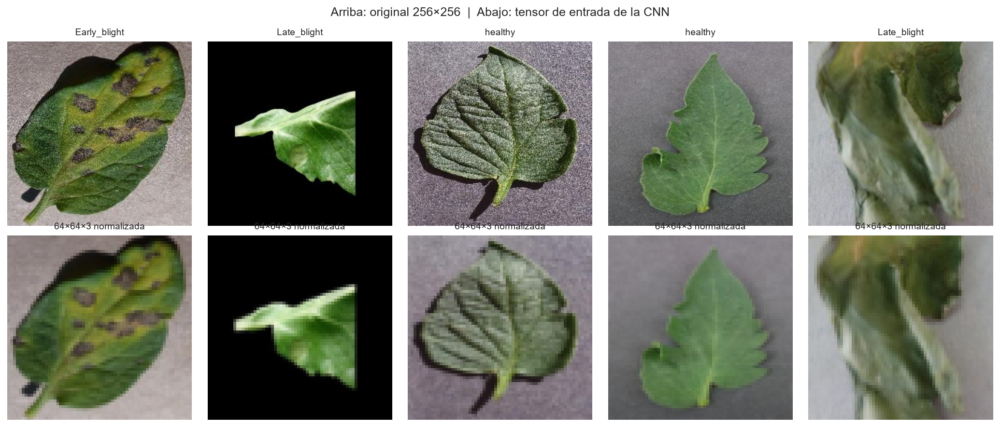

## 6. Metodología (CRISP-DM)

| Fase | Qué hicimos | Sección del notebook |
|---|---|---|
| Comprensión del negocio | Problema, objetivos, KPIs e impacto ético | 1 |
| Comprensión de los datos | Fuente, variante, balance, calidad y EDA | 2 |
| Preparación de los datos | Tensores normalizados, partición de la EP1 y aumento de datos | 3 |
| Modelado | Diseño de la CNN, entrenamiento y prueba de cinco configuraciones | 4 y 5 |
| Evaluación | Métricas, comparación con el MLP, feature maps, Grad-CAM y análisis de errores | 6 a 9 |
| Despliegue | No lo implementamos, pero lo discutimos en las conclusiones | 10 |

## 7. Diseño de la CNN

```
Entrada 64×64×3
  └─ Aumento de datos: espejo horizontal + rotación ±18°            (solo al entrenar)
  └─ Bloque 1: Conv2D(32, 3×3, same) → BatchNorm → ReLU → MaxPool(2×2)   → 32×32×32
  └─ Bloque 2: Conv2D(64, 3×3, same) → BatchNorm → ReLU → MaxPool(2×2)   → 16×16×64
  └─ Bloque 3: Conv2D(128, 3×3, same) → BatchNorm → ReLU → MaxPool(2×2)  →  8×8×128
  └─ Flatten → Dense(128, ReLU) → Dropout(0,4)
  └─ Dense(5) → Softmax
```

Estas son las decisiones que tomamos y por qué:

- **Tres bloques convolucionales.** Cada bloque agrega un nivel de detalle: primero bordes, después texturas y después partes de la lesión. Con imágenes de 64 px, tres reducciones dejan mapas de 8×8 sin achicar demasiado la imagen. Probamos también con dos y con cuatro bloques (sección 8.2) y ninguno fue mejor.
- **Filtros de 3×3.** Son el tamaño más usado (como en VGG). Apilando varios se cubre una zona grande de la imagen con pocos parámetros.
- **32, 64 y 128 filtros.** Duplicamos la cantidad cada vez que el pooling reduce la resolución. Al principio bastan pocos patrones simples, y en las capas profundas se combinan muchos más.
- **Padding `same`.** Mantiene el tamaño después de cada convolución, así la reducción la hace solo el pooling y no se pierden las lesiones que están en el borde de la hoja.
- **ReLU.** Da la no linealidad, es barata de calcular y evita que el gradiente se desvanezca.
- **BatchNormalization después de cada convolución.** Hace el entrenamiento más estable con una tasa de aprendizaje de 0,001, igual que en el MLP.
- **MaxPooling de 2×2.** Reduce el alto y el ancho a la mitad y se queda con la activación más fuerte de cada zona. Así importa más si el patrón aparece que su posición exacta.
- **Dense(128) con Dropout de 0,4.** Esta capa combina lo que extrajeron las convoluciones. Como concentra el 91,7 % de los parámetros, le pusimos un Dropout algo mayor que el 0,3 del MLP.
- **Salida Dense(5) con Softmax.** Son cinco clases excluyentes. Dejamos los logits en una capa separada porque Grad-CAM los necesita.
- **Pérdida `sparse_categorical_crossentropy`** (las etiquetas son enteros del 0 al 4) y **optimizador Adam** con tasa de 0,001 más `ReduceLROnPlateau`, que la baja a la mitad si la validación se estanca.
- **Entrenamiento:** lotes de 32, hasta 60 épocas y `EarlyStopping` con paciencia 8 que restaura la mejor época. Es exactamente el mismo protocolo del MLP, para que lo único distinto entre los dos modelos sea la arquitectura.

La red tiene 1.143.493 parámetros, el 36 % de los 3.181.061 del MLP. Lo
interesante es que las tres capas convolucionales suman solo 93.248, porque cada
filtro se reutiliza en toda la imagen; casi todo el peso está en la capa densa
(1.048.704). El campo receptivo pasa de 3×3 píxeles en la primera convolución a
8×8 en la segunda y 18×18 en la tercera.

## 8. Entrenamiento

### 8.1 Curvas de aprendizaje

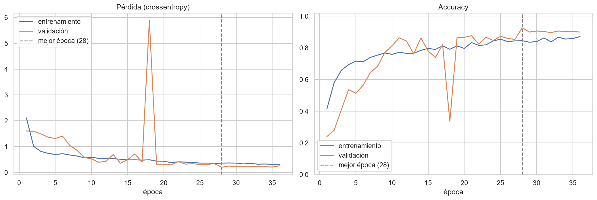

El entrenamiento se detuvo solo en la época 36 y se quedó con los pesos de la
época 28, que tuvo la menor pérdida de validación (0,201) y un 92,7 % de accuracy
en validación.

Algo que llama la atención en el gráfico es que la validación queda por encima
del entrenamiento casi todo el tiempo. No es un error. Keras calcula la accuracy
de entrenamiento con el aumento de datos y el Dropout activados, o sea, sobre
imágenes rotadas y con neuronas apagadas, mientras que en validación ambos están
desactivados. Por eso, para medir la brecha real, volvimos a calcular la accuracy
de entrenamiento en modo inferencia: 97,1 % en entrenamiento contra 91,0 % en
prueba, una brecha de 0,061.

En la época 18 hay un salto brusco: la pérdida de validación sube a 5,89 durante
una sola época y después vuelve a la normalidad. Lo atribuimos a BatchNormalization,
que con lotes chicos a veces desajusta sus estadísticas por un momento. Después
de eso `ReduceLROnPlateau` fue bajando la tasa de aprendizaje (0,0005, luego
0,00025 y 0,000125) y las curvas se estabilizaron. En el modelo que quedó
guardado no vemos señales de sobreajuste.

### 8.2 Prueba de otras configuraciones

Para respaldar el diseño, entrenamos cuatro variantes además de la base, todas
con el mismo protocolo y comparándolas solo con el conjunto de validación (la
prueba no la tocamos hasta el final).

| Variante | Parámetros | Accuracy de validación | Brecha* |
|---|---|---|---|
| 2 bloques (32, 64) | 2,12 M | 0,913 | −0,05 |
| 3 bloques, la base | 1,14 M | 0,927 | −0,08 |
| 4 bloques (32 a 256) | 0,92 M | 0,913 | +0,05 |
| Base sin aumento de datos | 1,14 M | 0,917 | +0,03 |
| Base sin Dropout | 1,14 M | 0,900 | +0,07 |

\* Accuracy de entrenamiento (con aumento y Dropout) menos accuracy de validación, en la mejor época.

Con 300 imágenes de validación, cada punto porcentual equivale a tres imágenes,
así que estas diferencias por sí solas no alcanzan para sacar conclusiones
fuertes. Lo que sí se repite es que, al quitar el aumento de datos o el Dropout,
la brecha crece, y que ni más ni menos bloques mejoran a la base. Antes de mirar
los resultados habíamos decidido cambiar la arquitectura solo si otra variante la
superaba por más de 3 puntos, y eso no pasó, así que nos quedamos con la base.

Un detalle curioso es que la versión de dos bloques tiene casi el doble de
parámetros, porque el `Flatten` recibe un mapa más grande (16×16×64).

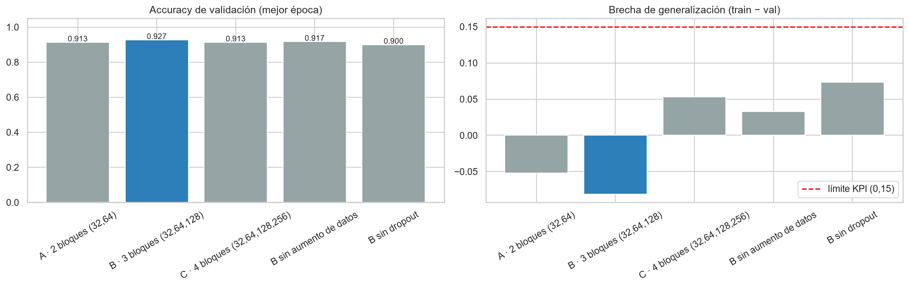

## 9. Evaluación del modelo

Sobre las 300 imágenes de prueba, la CNN obtuvo:

| Métrica | Valor |
|---|---|
| Accuracy | 0,9100 |
| Precision macro | 0,9172 |
| Recall macro | 0,9100 |
| F1-score macro | 0,9105 |

| Clase | Precision | Recall | F1 |
|---|---|---|---|
| healthy | 0,984 | 1,000 | 0,992 |
| Early_blight | 0,770 | 0,950 | 0,851 |
| Late_blight | 0,885 | 0,767 | 0,821 |
| Leaf_Mold | 0,947 | 0,900 | 0,923 |
| Bacterial_spot | 1,000 | 0,933 | 0,966 |

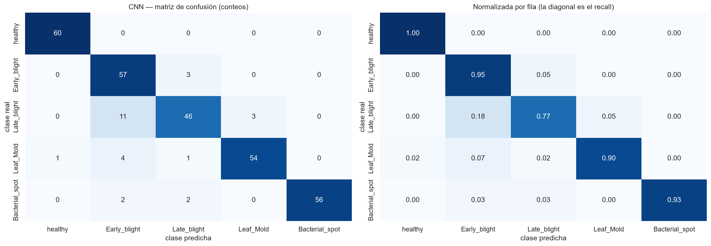

Las hojas sanas las reconoce todas, y solo una hoja enferma terminó clasificada
como sana. Bacterial_spot tampoco le cuesta: sus puntos oscuros son una textura
muy fácil de captar para los filtros.

La clase más difícil es Late_blight, con un recall de 0,77. De sus 14 errores, 11
los clasificó como Early_blight. Tiene sentido, porque los dos tizones producen
lesiones café sobre la hoja verde, y a 64×64 se pierde parte del detalle que los
diferencia. Por lo mismo, Early_blight tiene un recall alto (0,95) pero una
precision más baja (0,77): cuando la red duda entre los dos tizones, tiende a
elegir Early_blight.

Estos resultados calzan con lo que vimos en las curvas. El modelo no memorizó y
sus errores se concentran en el par de clases que más se parecen, no aparecen
repartidos al azar.

## 10. Comparación entre el MLP y la CNN

| Métrica | MLP (EP1) | CNN (EP2) |
|---|---|---|
| Accuracy en prueba | 0,8233 | 0,9100 |
| Precision macro | 0,8176 | 0,9172 |
| Recall macro | 0,8233 | 0,9100 |
| F1-score macro | 0,8192 | 0,9105 |
| Recall de las clases enfermas | 0,7792 | 0,8875 |
| Enfermas clasificadas como sanas (de 240) | 6 | 1 |
| Accuracy de entrenamiento (modo inferencia) | 0,9714 | 0,9714 |
| Brecha de generalización | 0,1481 | 0,0614 |
| Parámetros | 3.181.061 | 1.143.493 |
| Parámetros por imagen de entrenamiento | 2.272 | 817 |
| Épocas hasta detenerse | 59 | 36 |
| Tiempo total de entrenamiento (mismo equipo, CPU) | 15,1 s | 31,6 s |
| Tiempo por época | 0,26 s | 0,88 s |

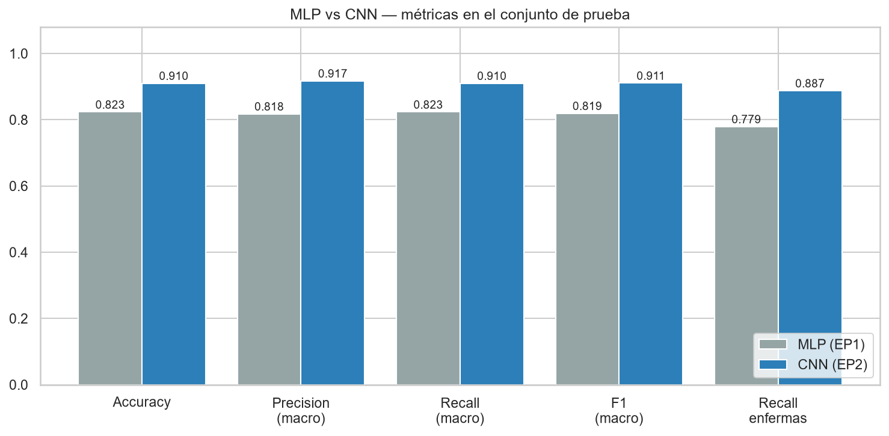
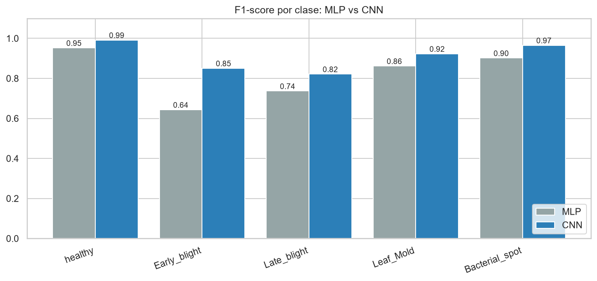
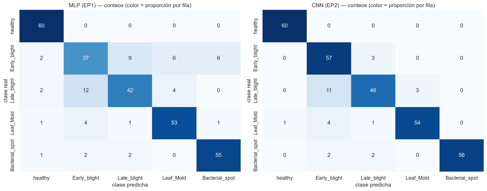

La CNN mejora 8,7 puntos en accuracy y 9,1 en F1, y es mejor en las cinco clases.
Donde más mejora es en Early_blight, que pasa de un F1 de 0,64 a 0,85. Es
justamente la clase que se reconoce por la forma de la lesión.

Para saber si la diferencia podía deberse al azar, aplicamos la prueba de
McNemar, que compara los dos modelos imagen por imagen. Hay 237 imágenes que
ambos aciertan y 17 que ambos fallan. En las 46 restantes, donde no coinciden,
la CNN acierta 36 y el MLP solo 10. El p-valor es 0,0002, así que la mejora no se
explica por la muestra.

La CNN además es más chica. El MLP gasta más de tres millones de parámetros solo
en conectar cada píxel con su primera capa, mientras que la CNN reutiliza los
mismos filtros en toda la imagen. Lo que sí le cuesta es el tiempo: cada época es
unas 3,4 veces más lenta, porque los filtros tienen que recorrer toda la imagen.
Como converge en menos épocas, el tiempo total termina siendo cerca del doble.
Medimos los dos modelos en el mismo equipo y sin GPU; con GPU esa diferencia
debería achicarse.

En generalización también gana la CNN. Por coincidencia, los dos modelos aciertan
exactamente 1.360 de las 1.400 imágenes de entrenamiento (0,9714), pero con
imágenes nuevas la CNN baja 6 puntos y el MLP 15.

Revisando las confusiones, la CNN eliminó varias que tenía el MLP: Early_blight
dejó de confundirse con Bacterial_spot (de 6 casos a 0) y con Leaf_Mold (de 6 a
0), y bastante menos con Late_blight (de 9 a 3). La que no logró resolver es
Late_blight confundida con Early_blight, que bajó apenas de 12 a 11.

| Aspecto | MLP | CNN |
|---|---|---|
| Cómo recibe la imagen | Como un vector, perdiendo qué píxeles son vecinos | Como tensor, conservando la estructura |
| Extracción de características | No la hace de forma explícita; aprende un peso por píxel | Filtros locales que se reutilizan en toda la imagen |
| Parámetros | Crecen con el tamaño de la imagen | Los filtros no dependen del tamaño |
| Si la lesión cambia de posición | La trata como un patrón distinto | La tolera en parte gracias al pooling |
| Costo de cómputo | Bajo | Mayor por época |
| Interpretabilidad | Poca | Se puede revisar con feature maps y Grad-CAM |
| Riesgo principal | Memorizar con pocos datos | Aprender atajos del dataset (nos pasó con el fondo) |

## 11. Feature maps y mapas de activación

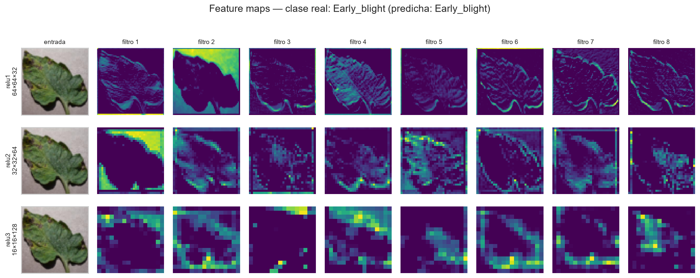

En la primera capa convolucional los mapas todavía se parecen a la hoja. Algunos
filtros marcan el contorno, otros las nervaduras, y uno se activa solo en el
fondo, como si la red hubiera aprendido por su cuenta a separar la hoja del
fondo. En la segunda capa ya no se ven píxeles sino zonas: texturas, bordes más
gruesos y manchas. En la tercera los mapas son mucho más abstractos. En la hoja
sana un filtro reproduce la silueta completa, y en la hoja con Early_blight varios
filtros se encienden justo sobre las manchas oscuras.

Esto es lo que se conoce como extracción automática de características. Nadie le
programó a la red un detector de bordes o de manchas; los aprendió sola a partir
de las etiquetas. El MLP no puede hacer algo así, porque al aplanar la imagen
pierde la información de qué está al lado de qué.

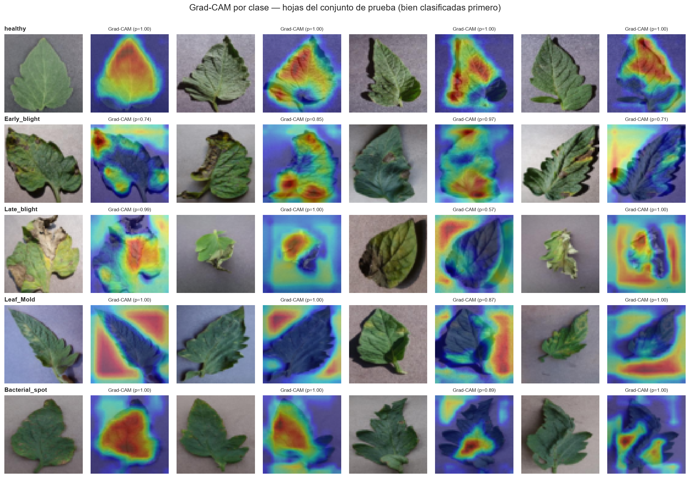
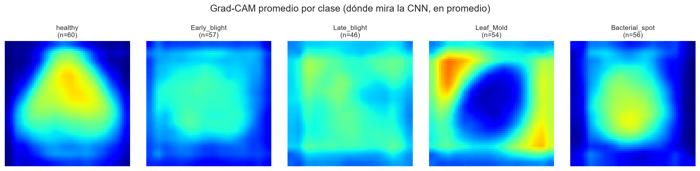

Con Grad-CAM revisamos en qué parte de la imagen se fija la red para decidir cada clase:

- En healthy mira la hoja completa, lo que tiene sentido porque "sana" significa que no hay lesiones en ninguna parte.
- En Bacterial_spot mira el interior de la hoja, donde están los puntos.
- En Early_blight se fija en las lesiones concretas. Es la clase donde mejor se nota que usa la enfermedad para decidir.
- En Late_blight el resultado es mixto: a veces mira la zona dañada y otras veces el borde de la imagen. Eso coincide con que sea la clase que más le cuesta.
- En Leaf_Mold mira el fondo y no la hoja. El mapa promedio tiene el centro frío y las esquinas calientes.

Esto último nos pareció importante, así que lo medimos. Calculamos qué porcentaje
de la activación de Grad-CAM cae en un marco de 8 píxeles alrededor de la imagen,
que ocupa el 43,75 % del área y es casi todo fondo:

| Clase | Grad-CAM en el marco | Color del fondo (azul − rojo) |
|---|---|---|
| healthy | 19,6 % | +2,8 |
| Early_blight | 32,4 % | −4,5 |
| Late_blight | 37,7 % | −5,4 |
| Leaf_Mold | 50,4 % | +12,2 |
| Bacterial_spot | 20,5 % | −7,4 |

Las clases que la red reconoce por la hoja ponen alrededor de un 20 % de su
atención en el marco. Leaf_Mold pone más de la mitad, y además es la clase con el
fondo más azulado. Lo interpretamos como una señal moderada de que, para esa
clase, la red se apoya en parte en el color del fondo de las fotos y no solo en la
enfermedad.

## 12. Análisis de errores

La red acertó 273 de las 300 imágenes. En promedio, cuando acierta está bastante
segura (confianza de 0,93) y cuando se equivoca duda más (0,65). Aun así hubo 5
errores con una confianza de 0,90 o más, así que la confianza no basta para
detectar todos los errores.

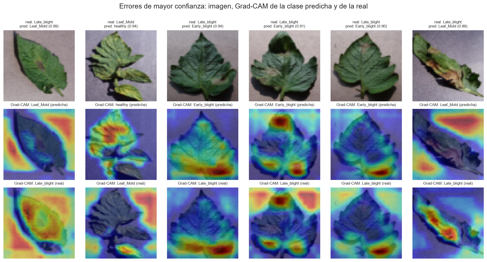

Al mirar los errores más "seguros" junto a su Grad-CAM aparecen tres situaciones:

- Dos hojas de Late_blight clasificadas como Leaf_Mold (con confianza de 0,99 y 0,86). La red estaba mirando el fondo, así que es el mismo atajo que describimos arriba.
- Tres hojas de Late_blight clasificadas como Early_blight (0,94, 0,91 y 0,90). Aquí los Grad-CAM de las dos clases apuntan a la misma lesión: la red encuentra la mancha correcta, pero no logra decidir de qué tizón se trata. Es un problema de parecido entre clases, no un atajo.
- Una hoja de Leaf_Mold clasificada como sana (0,94), que es el único caso de enferma tomada por sana. Tiene manchas amarillas suaves, típicas de una infección que recién empieza, y la red la confundió con tejido sano.

Estos dos tipos de error necesitan soluciones distintas. El problema del fondo se
arregla con datos más variados, y la confusión entre tizones probablemente
necesita más resolución o un modelo preentrenado.

## 13. Impacto ético

- **Falsos negativos.** Una hoja enferma que pasa como sana tiene consecuencias reales: se puede perder parte de la cosecha y la enfermedad sigue avanzando. Por eso lo medimos aparte. La CNN lo redujo de 6 casos a 1.
- **Sesgo del dataset.** Las fotos de PlantVillage son de laboratorio, con hojas sueltas y fondos uniformes. Lo que encontramos con Leaf_Mold muestra que este riesgo es concreto: un 91 % aquí no asegura el mismo resultado con fotos tomadas en terreno.
- **Uso responsable.** El modelo debería servir como apoyo al agrónomo y no como reemplazo. Lo ideal sería mostrar la confianza de cada predicción y mandar a revisión humana los casos dudosos.
- **Costo ambiental y económico.** Un error puede llevar a aplicar químicos de más, o a no aplicarlos cuando sí hacía falta.

## 14. Conclusiones

La CNN superó al MLP en todas las métricas que medimos: 91,0 % de accuracy contra
82,3 % y 91,1 % de F1 contra 81,9 %. La diferencia es estadísticamente
significativa y se cumplen los seis KPIs. Con esto confirmamos lo que concluimos
en la EP1: el límite del MLP venía de su arquitectura.

La diferencia de fondo entre los dos modelos es cómo tratan la imagen. El MLP la
aplana y aprende un peso por cada píxel, sin saber cuáles son vecinos. La CNN la
mantiene como imagen, recorre filtros pequeños por toda la superficie y resume con
pooling. Eso le permite reconocer la forma de las lesiones, que era justamente lo
que el MLP no podía hacer.

Las principales ventajas que vimos en la CNN fueron:

- mejor desempeño con un tercio de los parámetros;
- mejor generalización (brecha de 0,06 contra 0,15);
- menos confusiones entre clases que se distinguen por la forma de la lesión;
- la posibilidad de revisar qué está mirando, lo que nos permitió descubrir un sesgo del dataset.

También tiene limitaciones:

- es unas 3,4 veces más lenta por época;
- sigue confundiendo los dos tizones;
- en Leaf_Mold se apoya en parte en el fondo;
- algunos de sus errores son muy confiados.

Además, trabajamos con una sola partición y una sola semilla, y con 300 imágenes
de prueba, donde cada imagen vale 0,33 puntos.

Como mejoras basadas en regularización, el aumento de datos y el Dropout ya
mostraron su aporte en la sección 8.2. Los siguientes pasos que proponemos son:

- reemplazar `Flatten` por `GlobalAveragePooling2D`, lo que dejaría la capa densa en unos 16 mil parámetros en vez de un millón;
- agregar regularización L2 en la capa densa y `SpatialDropout2D` en los bloques convolucionales;
- usar *label smoothing* para que la red no sea tan confiada;
- sumar aumentos de color y de fondo, o recortar la hoja, para eliminar el atajo de Leaf_Mold.

Fuera de la regularización, valdría la pena probar imágenes de 128×128,
validación cruzada con varias semillas y transfer learning con alguna red
preentrenada, como MobileNetV2 o EfficientNet.

## 15. Reproducibilidad

El notebook [`notebooks/plantvillage_cnn.ipynb`](notebooks/plantvillage_cnn.ipynb)
quedó guardado con todas sus salidas. Lo ejecutamos en un equipo local sin GPU
(TensorFlow 2.21 y Keras 3.15) y la corrida completa tardó unos 4 minutos. Usamos
la semilla 1102 en todo el flujo, y al ejecutarlo dos veces seguidas en el mismo
equipo obtuvimos exactamente las mismas métricas. En otro equipo, por ejemplo
Colab con GPU, los números pueden variar levemente, pero el notebook recalcula
todas las tablas y el resumen final.

Lo que genera el notebook queda guardado así:

- **Modelo:** `models/cnn_plantvillage.keras`.
- **Métricas e historial** (en `models/`): `metricas_globales_cnn.csv`, `metricas_por_clase_cnn.csv`, `matriz_confusion_cnn.csv`, `kpis_cnn.csv` e `historial_entrenamiento_cnn.csv`.
- **Comparaciones** (en `models/`): `comparacion_mlp_cnn.csv`, `comparacion_configuraciones_cnn.csv` y `mcnemar_mlp_vs_cnn.csv`.
- **Predicciones:** `models/predicciones_test_cnn.csv`.
- **Figuras:** 21 gráficos en `images/`, todos con el prefijo `cnn_`.

Las instrucciones para ejecutarlo en local o en Colab están en el [`README.md`](README.md).
