# Informe técnico EP3 — Optimización y auditoría de un clasificador de enfermedades en hojas de tomate: MLP vs CNN

**Asignatura:** TLY1102 — Técnicas Avanzadas de Machine Learning I
**Evaluación:** Parcial N°3 — Presentación y defensa técnica del proyecto
**Notebook:** [`notebooks/plantvillage_ep3.ipynb`](notebooks/plantvillage_ep3.ipynb)
**Trabajos anteriores:** EP1 ([`informe_tecnico.md`](informe_tecnico.md)) y EP2 ([`informe_ep2.md`](informe_ep2.md))

En esta tercera evaluación juntamos el MLP de la EP1 y la CNN de la EP2 en un
**pipeline integrado** y los sometimos al mismo proceso: medimos el aporte de cada
técnica de regularización, optimizamos sus hiperparámetros con 63 experimentos
controlados (un cambio a la vez, Random Search y confirmación con tres semillas) y
los auditamos con métricas, Grad-CAM, LIME y un análisis de sesgos.

En resumen:

- **La optimización confirmó las configuraciones anteriores.** La única mejora aparente (L2 en la CNN, +1,6 pp) resultó ser en gran parte efecto de la semilla.
- **La CNN sigue siendo claramente mejor** que el MLP: F1 macro de 0,914 frente a 0,831 en una prueba ampliada de 5.350 imágenes nuevas (McNemar p ≈ 10⁻⁵⁶), y solo el 0,5 % de las hojas enfermas pasa como sana.
- **El hallazgo más importante estaba en los datos.** En PlantVillage cada clase viene de sus propias sesiones de captura, y los modelos aprenden en parte la sesión (el fondo, el tinte) y no solo la enfermedad. Al neutralizar el fondo, la CNN pierde 55 puntos de recall en Leaf_Mold, y las Late_blight de una de las sesiones se detectan solo en el 68 % de los casos.
- **Recomendamos la CNN como herramienta de apoyo en condiciones de laboratorio**, todavía no para fotos de campo.

---

## 1. Problema de negocio

El tomate es un cultivo de alto valor y muy expuesto a enfermedades de la hoja.
Hoy el diagnóstico depende de que un agrónomo revise las plantas a ojo, lo que es
lento, no escala bien y depende de la experiencia de quien revisa. Si una
enfermedad como el tizón tardío se detecta tarde, puede acabar con un cultivo en
pocos días. La idea del proyecto es que una foto de la hoja sirva para reconocer
la enfermedad, de modo que el productor pueda decidir qué sectores revisar primero
y tratar solo donde hace falta.

Planteado como problema de machine learning: dada la imagen de una hoja de
tomate, clasificarla en una de cinco clases (`healthy`, `Early_blight`,
`Late_blight`, `Leaf_Mold`, `Bacterial_spot`).

### 1.1 De dónde venimos y qué cambia en la EP3

| Evaluación | Modelo | Prueba (300 imágenes) | Conclusión |
|---|---|---|---|
| EP1 | MLP `Flatten → 256 → 128 → 5` | accuracy 82,33 %, F1 81,92 % | El techo del MLP es arquitectónico: al aplanar la imagen se pierde la vecindad entre píxeles. |
| EP2 | CNN de 3 bloques `32 → 64 → 128` | accuracy 91,00 %, F1 91,05 % | La CNN supera al MLP con un tercio de los parámetros, pero en Leaf_Mold mira el fondo. |

En la EP3 no construimos nada desde cero. Tomamos los dos modelos, los pusimos en
un **pipeline integrado** (actividades 3.4 y 3.5) y los sometimos al mismo
proceso: medimos el aporte de cada técnica de regularización, optimizamos sus
hiperparámetros con experimentos controlados y los auditamos con métricas,
herramientas de IA explicable y un análisis de sesgos. Mantuvimos la variante del
grupo para no perder la trazabilidad: las mismas 2.000 imágenes, la misma
partición 70/15/15, la semilla 1102 y la resolución de 64 × 64.

La EP2 había dejado varias propuestas sin probar, y la EP3 las convierte en experimentos:

| Pendiente de la EP2 | Cómo lo abordamos en la EP3 |
|---|---|
| La capa densa concentra el 91,7 % de los parámetros | Probamos cabeza `GlobalAveragePooling`, L2 y menos neuronas |
| Inestabilidad de la validación (época 18) | Probamos tasa de aprendizaje y tamaño de lote |
| 5 errores con confianza ≥ 0,90 | Probamos *label smoothing* y medimos la calibración (ECE) |
| Leaf_Mold reconocida por el fondo | Aumento de color con balance de blancos y una prueba causal del fondo |
| Solo 300 imágenes de prueba | Confirmación con 3 semillas y una prueba ampliada de 5.350 imágenes |
| El MLP nunca se optimizó con el mismo rigor | El MLP pasa por exactamente el mismo pipeline |

## 2. Objetivos

**General:** optimizar y auditar un MLP y una CNN dentro de un pipeline integrado
y reproducible, y seleccionar con evidencia experimental el modelo más adecuado,
considerando desempeño, generalización, explicabilidad e implicancias éticas.

**Específicos:**

1. Reorganizar el trabajo de la EP1 y la EP2 en un pipeline con funciones documentadas.
2. Medir el aporte de cada técnica de regularización con curvas de aprendizaje y métricas.
3. Optimizar los hiperparámetros de ambos modelos con experimentos controlados y Random Search, confirmando los candidatos con varias semillas.
4. Evaluar los modelos finales con accuracy, precision, recall, F1, ROC-AUC, matriz de confusión y calibración.
5. Auditar el comportamiento con Grad-CAM y LIME, identificar sesgos del dataset y medir su efecto.
6. Comparar el MLP optimizado con la CNN final y justificar la recomendación.

## 3. KPIs

Fijamos los KPIs **antes** de entrenar. Los dos primeros piden al menos igualar a
la CNN de la EP2; los demás miden cosas que la EP2 no podía medir bien:
estabilidad, sesgo y errores costosos sobre muchas más imágenes.

| KPI | Meta | Por qué importa |
|---|---|---|
| F1 macro en la prueba oficial | ≥ 0,91 (la CNN de la EP2) | La optimización no debe empeorar el modelo anterior |
| F1 macro en la prueba ampliada | ≥ 0,90 | Estimación mucho más estable (miles de imágenes) |
| Recall de las clases enfermas (prueba oficial) | ≥ 0,90 | Una enferma no detectada sigue contagiando |
| Enfermas clasificadas como sanas (prueba ampliada) | ≤ 1 % | Es el error más costoso para el productor |
| Brecha de generalización (accuracy train − prueba) | ≤ 0,10 | Más exigente que el 0,15 de la EP1 y la EP2 |
| Estabilidad entre semillas (desviación del F1 de validación) | ≤ 0,02 | Un resultado que depende de la semilla no es confiable |
| Diferencia de recall entre sesiones de captura de una misma clase | ≤ 0,15 | KPI de **sesgo**: el modelo no debería funcionar peor según dónde se tomó la foto |

Los resultados están en la sección 12: la CNN cumple 4 de 7 y el MLP 1 de 7.

Separamos el recall de las enfermas del accuracy porque los errores no cuestan lo
mismo. Una hoja enferma clasificada como sana queda sin tratar y sigue
contagiando; una sana marcada como enferma solo cuesta una revisión. El KPI de
sesgo es nuevo en esta evaluación y salió del análisis de los datos (sección 5).

## 4. Fuentes de datos

Usamos **PlantVillage** de Kaggle
([`emmarex/plantdisease`](https://www.kaggle.com/datasets/emmarex/plantdisease)),
uno de los datasets autorizados en la pauta. Son fotos de hojas sobre fondo
uniforme, tomadas en laboratorio, JPG RGB de 256 × 256 con la etiqueta en el
nombre de la carpeta. De las cinco clases de la variante hay 7.579 imágenes.

| Conjunto | Imágenes | Uso |
|---|---|---|
| Entrenamiento (EP1) | 1.400 (280 por clase) | Ajustar los pesos |
| Validación (EP1) | 300 (60 por clase) | EarlyStopping y **todas** las decisiones de la optimización |
| Prueba oficial (EP1) | 300 (60 por clase) | Evaluación final, comparable con la EP1 y la EP2 |
| **Prueba ampliada (nueva)** | **5.350** (desbalanceada) | Auditoría final con muchas más imágenes; ningún modelo la vio |

La prueba ampliada son todas las imágenes de las cinco clases que no entraron al
muestreo de la EP1, sin las que podían filtrar información: 220 fotos de hojas que
ya estaban en la muestra (la misma hoja fotografiada otro día), 7 duplicados
exactos y 2 con etiqueta dudosa.

Además usamos los artefactos de las evaluaciones anteriores que están en `models/`:
la partición exacta, las predicciones y los modelos `mlp_plantvillage.keras` y
`cnn_plantvillage.keras`. Al recargarlos, reproducen exactamente el 82,33 % y el
91,00 % oficiales.

## 5. Preparación y análisis exploratorio de los datos

### 5.1 Calidad

- No hay imágenes corruptas; todas son RGB de 256 × 256.
- Hay **4 pares de duplicados exactos** (mismo contenido, distinto nombre) dentro de entrenamiento.
- Las sesiones de invernadero numeran cada hoja (`Leaf 1 Day 7`, `Leaf 1 Day 18`...). Encontramos **38 hojas con varias fotos**, 16 repartidas entre subconjuntos, y **7 imágenes de prueba cuya hoja también está en entrenamiento**. La EP1 particionó por imagen y no por hoja.
- **Etiquetas dudosas:** en entrenamiento hay **una foto de un tomate (el fruto) etiquetada como hoja sana**, y fuera de la muestra hay dos hojas sin lesiones guardadas en la carpeta de Late_blight.

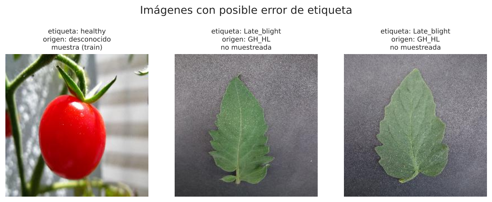

### 5.2 El hallazgo principal: cada clase viene de su propia sesión de captura

El nombre de cada archivo trae un prefijo que identifica la sesión donde se tomó
la foto (`RS_Erly.B 8378.JPG`, `GHLB2 Leaf 8665.JPG`, `Crnl_L.Mold 7083.JPG`...).
Al cruzarlo con la clase, ninguna sesión aparece en dos clases:

| Clase | Sesiones de captura (muestra de la EP1) |
|---|---|
| healthy | `RS_HL` (62 %), `GH_HL` (38 %) |
| Early_blight | `RS_Erly.B` (100 %) |
| Late_blight | `RS_Late.B` (50 %), `GHLB*` (50 %) |
| Leaf_Mold | `Crnl_L.Mold` (100 %) |
| Bacterial_spot | `GCREC_Bact.Sp` (81 %), `UF.GRC_BS_Lab` (19 %) |

O sea, la clase está **confundida con la sesión**. Cada sesión tiene su fondo, su
luz y su cámara, así que un modelo puede acertar reconociendo la sesión en vez de
la enfermedad. El fondo de Leaf_Mold es el más azulado (azul − rojo = +9,9), y las
sesiones de invernadero `GHLB*` usan fondos mucho más oscuros. Este sesgo de
captura está documentado en la literatura: Noyan (2022) entrenó un modelo con
solo 8 píxeles del fondo de PlantVillage y obtuvo 49 % de accuracy en 38 clases,
frente a 2,6 % al azar.

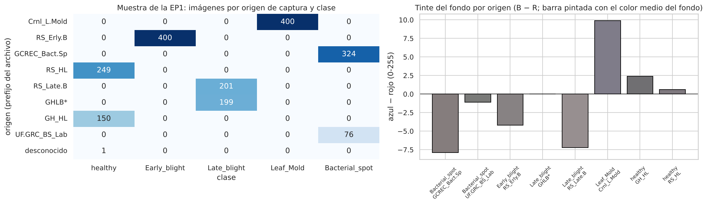
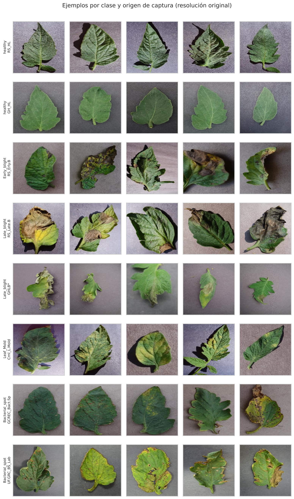

Lo más llamativo es que el sesgo ya estaba en los resultados de la EP2 y no lo
habíamos visto. **Los 14 errores de la CNN de la EP2 en Late_blight vienen todos
de la sesión `RS_Late.B`** (recall 0,62), mientras que las Late_blight del
invernadero se reconocían al 100 %. Las `RS_Late.B` se confundían con
Early_blight, que es 100 % de la misma sesión RS: mismo fondo, misma luz. En
Bacterial_spot, la sesión minoritaria (`UF.GRC`, 19 % de la clase) tenía recall
0,70 frente a 0,98 de la mayoritaria.

### 5.3 Preparación

Mismo preprocesamiento de la EP1 y la EP2: remuestreo bilineal a 64 × 64, escalado
a [0, 1] y etiquetas en one-hot (para poder usar *label smoothing*). El aumento de
datos va dentro del modelo y solo actúa al entrenar, en tres intensidades:

| Tipo | Transformaciones |
|---|---|
| `geom` (EP1/EP2) | espejo horizontal + rotación ±18° |
| `geom+color` | `geom` + brillo ±15 %, contraste ±20 % y **balance de blancos** ±10 % por canal (capa propia) |
| `geom+color+zoom` | `geom+color` + zoom y traslación ±10 % |

El balance de blancos lo implementamos como una capa de Keras propia
(`BalanceBlancoAleatorio`) porque ataca directamente el tinte del fondo de cada
sesión. No usamos cambios fuertes de tono, porque el amarillo de Leaf_Mold y el
café de los tizones son síntomas.

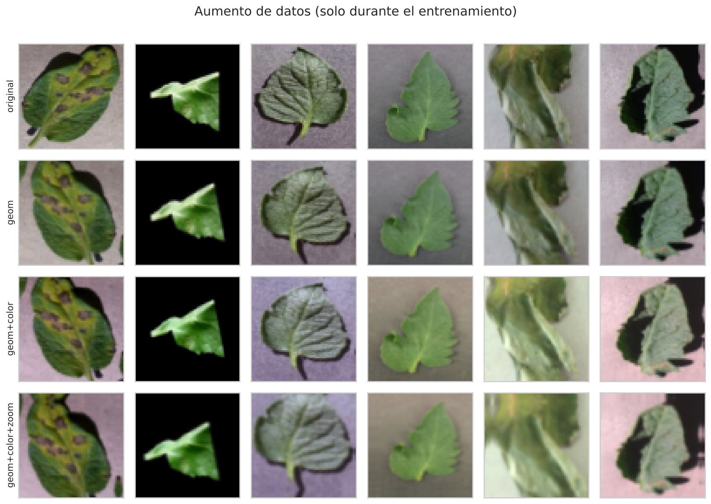

## 6. Metodología (CRISP-DM)

| Fase | Qué hicimos | Sección del notebook |
|---|---|---|
| Comprensión del negocio | Problema, objetivos, KPIs y ética | 1 |
| Comprensión de los datos | Calidad, duplicados, hojas repetidas, sesiones de captura y fondo | 4.2 |
| Preparación de los datos | Tensores, one-hot, aumento de datos en tres niveles, prueba ampliada | 4.1, 4.3 |
| Modelado | Líneas base, ablación de regularización, OFAT, Random Search y confirmación con 3 semillas | 5, 6, 7 |
| Evaluación | Prueba oficial y ampliada, McNemar, Grad-CAM, LIME, sesgos y robustez | 8, 9, 10 |
| Despliegue | No se implementa; discutimos requisitos y riesgos | 11, 13 |

## 7. Arquitectura del pipeline integrado

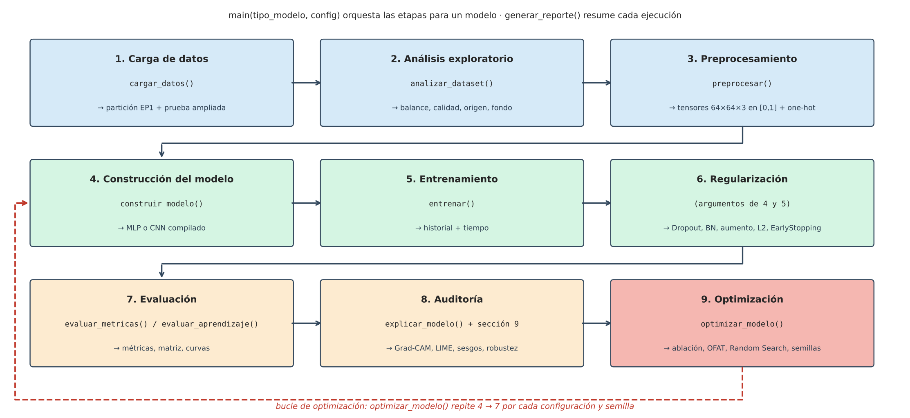

| Etapa | Función | Qué hace y por qué |
|---|---|---|
| 1. Carga | `cargar_datos()` | Lee la partición exacta de la EP1 (una sola fuente de verdad) y arma la prueba ampliada sin fugas. |
| 2. EDA | `analizar_dataset()` | Balance, calidad, duplicados, hojas repetidas, sesiones de captura y color de fondo. |
| 3. Preprocesamiento | `preprocesar()`, `construir_aumento()` | Tensores 64×64×3 en [0, 1], one-hot y aumento de datos como capas del modelo. |
| 4. Construcción | `construir_modelo(tipo_modelo, ...)` | Una sola interfaz para MLP y CNN; todos los hiperparámetros son argumentos. Con la configuración base reproduce exactamente el MLP de la EP1 y la CNN de la EP2. |
| 5. Entrenamiento | `entrenar()` | Mismo protocolo para todo: hasta 60 épocas, lote 32, Adam, EarlyStopping (paciencia 8) y ReduceLROnPlateau. |
| 6. Regularización | argumentos de 4 y 5 | Dropout, BatchNorm, L2, aumento, *label smoothing* y EarlyStopping se activan por configuración. |
| 7. Evaluación | `evaluar_metricas()`, `evaluar_aprendizaje()` | Accuracy, precision, recall, F1, ROC-AUC, recall de enfermas, enfermas→sana, ECE, curvas y diagnóstico. |
| 8. Auditoría | `explicar_modelo()` + sección 9 | Grad-CAM, LIME, rendimiento por sesión, intervención del fondo y robustez. |
| 9. Optimización | `optimizar_modelo()`, `experimento()` | Repite 4 → 7 por configuración y semilla, guarda cada resultado en caché y compara solo con validación. |
| Orquestación | `main()`, `generar_reporte()` | Ejecuta el flujo completo para un modelo y resume el resultado (estructura de la Actividad 3.4). |

Las etapas se conectan pasando estructuras simples: `cargar_datos()` entrega
DataFrames, `preprocesar()` los convierte en tensores, `construir_modelo()` y
`entrenar()` producen un modelo con su historial, y `evaluar_*()` y
`explicar_modelo()` generan las métricas y explicaciones que `generar_reporte()`
resume en una fila. `optimizar_modelo()` es el bucle que llama a las etapas 4 a 7
una vez por cada configuración y semilla.

Decisiones de diseño que mantuvimos en todo el pipeline:

1. **Validación para decidir y prueba solo al final.** La prueba oficial y la ampliada no participan en ninguna decisión.
2. **Un cambio a la vez** en cada experimento.
3. **Mismas condiciones para MLP y CNN:** datos, preprocesamiento, aumento, tope de épocas, callbacks, optimizador y semillas.
4. **Reproducibilidad:** semilla 1102, operaciones deterministas de TensorFlow en CPU y una caché (`models/ep3_experimentos/`) con un JSON por experimento (configuración, historial y métricas), identificado por un hash de la configuración. Con `REUTILIZAR_RESULTADOS = True` el notebook se vuelve a ejecutar en minutos sin reentrenar.

## 8. Regularización: cuánto aporta cada técnica

Para medir el aporte de cada técnica partimos del modelo base regularizado y
quitamos **una técnica a la vez**, dejando todo lo demás igual. Al final quitamos
todas. Si quitar una técnica empeora la validación o agranda la brecha, esa técnica
estaba ayudando a generalizar.

| Se quita… | MLP: F1 val | MLP: brecha | CNN: F1 val | CNN: brecha | CNN: pérdida val |
|---|---|---|---|---|---|
| nada (base) | 0,882 | 0,095 | 0,910 | 0,069 | 0,231 |
| Dropout | 0,869 | 0,116 | 0,892 | 0,067 | 0,299 |
| BatchNorm | **0,370** | 0,002 | **0,924** | 0,063 | 0,208 |
| Aumento de datos | **0,781** | **0,196** | 0,917 | 0,076 | 0,258 |
| EarlyStopping | 0,865 | 0,104 | 0,902 | 0,067 | 0,251 |
| L2 (solo el MLP la usa) | 0,871 | 0,106 | — | — | — |
| todas | 0,785 | **0,164** | 0,897 | **0,103** | **0,399** |

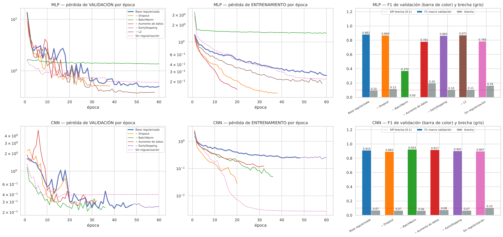

Lo que sacamos de esta tabla y de las curvas:

- **La regularización pesa mucho más en el MLP (+9,7 pp) que en la CNN (+1,3 pp).** El MLP tiene 2.272 parámetros por imagen de entrenamiento y ninguna restricción espacial. En la CNN, compartir los filtros en toda la imagen ya es una forma de regularización de la arquitectura: incluso la CNN **sin ninguna** regularización (0,897) supera al MLP regularizado (0,882).
- **En el MLP, el aumento de datos es la técnica decisiva.** Sin él, la pérdida de entrenamiento cae en picada, la brecha se duplica y EarlyStopping lo corta en la época 20. Sin BatchNorm el MLP directamente no aprende (la pérdida de entrenamiento queda plana): con 12.288 entradas, normalizar las activaciones es lo que hace posible la optimización.
- **En la CNN, la técnica con más efecto es el Dropout** (−1,8 pp al quitarlo, y la red sobreajusta desde la época 12). La CNN sin ninguna regularización muestra el sobreajuste clásico: acierta el **100 %** del entrenamiento, su pérdida de entrenamiento cae a 0,003 y la de validación queda clavada en 0,4.
- **Un resultado que no esperábamos:** quitar BatchNorm mejoró la CNN 1,4 pp y dejó las curvas sin los picos de inestabilidad que también vimos en la EP2. Es una sola semilla (~4 imágenes), así que no lo dimos por hecho. Como el plan de optimización ya estaba fijado, no lo agregamos a la búsqueda: queda como primer experimento de la próxima iteración.
- **EarlyStopping no cambia mucho el F1, pero ahorra tiempo:** la curva sin EarlyStopping es la misma de la base, solo que continúa 12 épocas más sin mejorar.

## 9. Optimización de hiperparámetros

### 9.1 Plan y estrategia

Mantuvimos fija la arquitectura general de cada modelo y optimizamos sus
hiperparámetros. Cada experimento cambia **un solo valor** respecto de la base y
responde a una hipótesis:

| Hiperparámetro | Base | Valores probados | Hipótesis |
|---|---|---|---|
| Tasa de aprendizaje | 0,001 | 0,0005 · 0,002 | Una tasa menor estabilizaría la validación |
| Tamaño de lote | 32 | 16 · 64 | Lotes de 64 estabilizarían BatchNorm |
| Dropout | 0,4 (CNN) · 0,3 (MLP) | 0,2 y 0,6 (CNN) · 0,2 y 0,5 (MLP) | Más Dropout reduciría la brecha |
| L2 | 0 (CNN) · 1e-4 (MLP) | 1e-4 y 1e-3 (CNN) · 0 y 1e-3 (MLP) | Penalizar pesos grandes reduciría la memorización de la capa densa |
| Aumento de datos | geom | geom+color · geom+color+zoom | Variar luz y tinte le quitaría valor al fondo |
| *Label smoothing* | 0 | 0,1 | Reduciría la sobreconfianza |
| Neuronas de la capa densa (CNN) | 128 | 64 · 256 | Con 1.400 imágenes, 64 podrían bastar |
| Cabeza (CNN) | Flatten | GlobalAveragePooling | Bajaría los parámetros de 1,14 M a ~110 mil |
| Capas ocultas (MLP) | (256, 128) | (128, 64) · (512, 256) | Más neuronas no levantarían el techo del MLP |

Usamos cuatro estrategias, todas evaluadas solo con validación:

1. **Un hiperparámetro a la vez (OFAT):** una búsqueda en grilla de una dimensión alrededor de la base. Aísla el efecto de cada cambio.
2. **Combinación OFAT:** juntar los valores que mejoraron al menos 1 pp sin superar el KPI de brecha.
3. **Random Search:** combinaciones al azar para detectar interacciones. Una grilla completa no era viable: son 2.916 combinaciones para la CNN (≈ 5 días de CPU).
4. **Confirmación con 3 semillas** de los candidatos, porque con 300 imágenes de validación 1 pp son solo 3 imágenes.

La regla de selección la fijamos **antes** de ver los resultados: gana el mejor F1
macro medio de las 3 semillas. Las configuraciones a menos de 1 pp se consideran
empatadas, y entre ellas gana la de menor brecha y, si persiste el empate, la de
menos parámetros.

### 9.2 Resultados

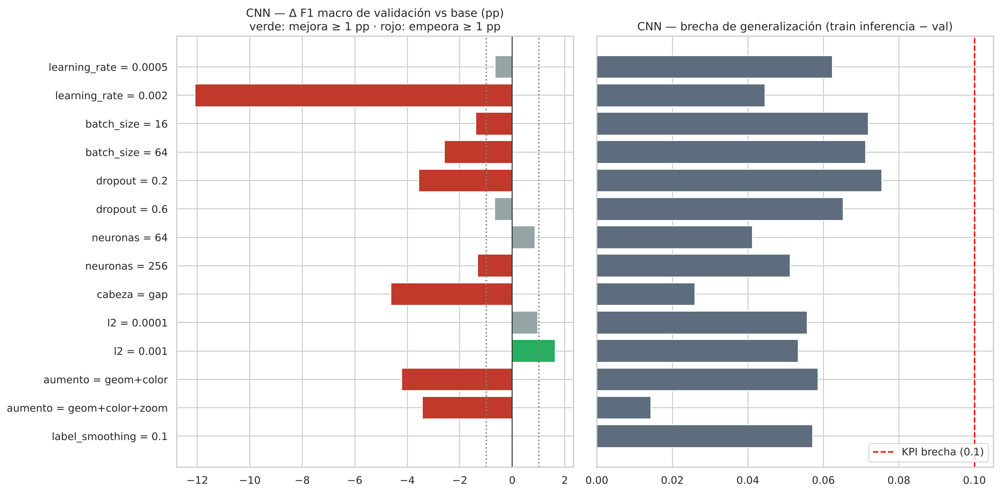
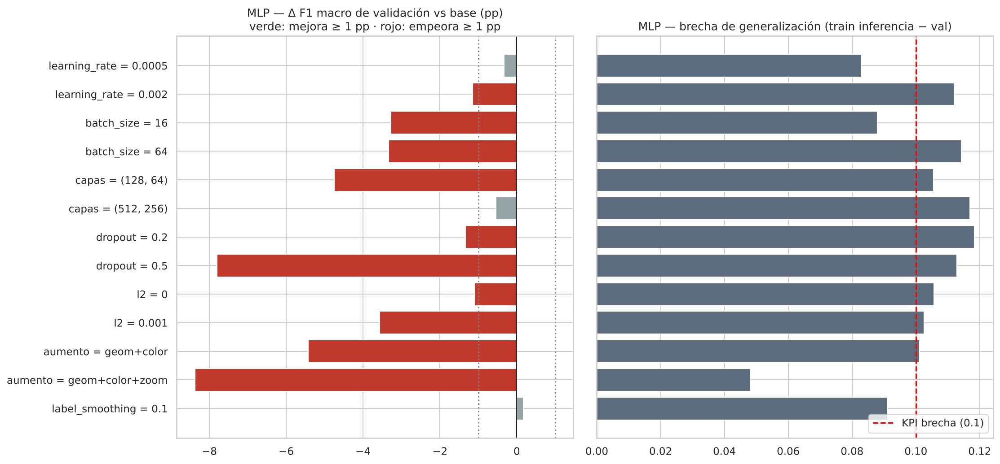

**CNN (base: F1 0,910).** De 14 cambios, 10 empeoraron. La única mejora que pasó
el umbral fue **L2 = 0,001 (+1,6 pp)**. Otras hipótesis no se cumplieron:

- La tasa de 0,002 desestabiliza la red (−12,1 pp).
- Los lotes de 16 y 64 empeoran (−1,4 y −2,6 pp).
- La cabeza GAP baja la brecha a 0,026, pero por **underfitting** (−4,6 pp): al promediar se pierde la posición de la lesión.
- *Label smoothing* deja el F1 igual pero empeora la calibración (ECE 0,107 frente a 0,041): el modelo queda subconfiado.
- El aumento de color baja la validación ~4 pp (lo explicamos en la sección 11.5).

GAP y *label smoothing* eran propuestas de nuestra propia EP2, y la evidencia nos
dijo que no funcionan en este problema.

**MLP (base: F1 0,882).** Ningún cambio lo mejoró por 1 pp o más. Con capas de
(512, 256) memoriza más (accuracy de entrenamiento 0,994) y generaliza igual. Con
(128, 64) le falta capacidad. Es la misma conclusión de la EP1: **el techo del MLP
es arquitectónico**.

**Random Search.** Ninguna de las 14 combinaciones superó a su base. Además
aparecieron interacciones que OFAT no podía anticipar: una CNN con 64 neuronas,
Dropout 0,6 y lote 16 directamente no aprendió (F1 0,11), aunque cada cambio por
separado era inofensivo.

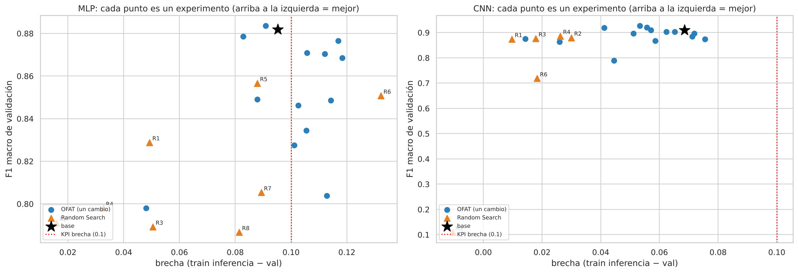

### 9.3 Confirmación con tres semillas y selección

| Modelo | Candidata | F1 val (media ± desv., 3 semillas) | Brecha media | Decisión |
|---|---|---|---|---|
| MLP | Base (EP1) | 0,868 ± 0,017 | 0,102 | **Elegida** |
| MLP | Mejor Random | 0,854 ± 0,003 | 0,094 | −1,4 pp |
| CNN | Base (EP2) | 0,913 ± 0,003 | 0,055 | **Elegida** (empate, menor brecha) |
| CNN | L2 = 0,001 | 0,917 ± 0,008 | 0,061 | Empatada (+0,4 pp) |
| CNN | Mejor Random | 0,850 ± 0,050 | 0,022 | Inestable |

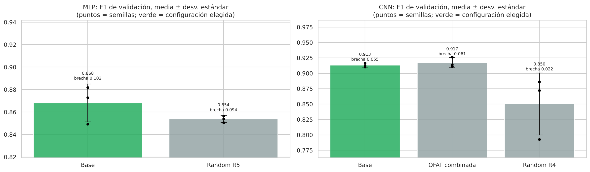

La confirmación cambió la decisión. **La mejora de L2 era en buena parte suerte de
la semilla:** daba +1,6 pp con la semilla 1102, pero con las otras dos la ventaja
casi desapareció (+0,4 pp de media, ≈ 1 imagen). Según la regla, queda empatada
con la base, y gana la base por menor brecha y menor variabilidad. Sin este paso
habríamos adoptado una mejora que no existe.

**Resultado de la optimización:** después de 63 experimentos distintos, las
configuraciones de la EP1 y la EP2 se confirmaron como las mejores del espacio
explorado. Lo leemos como un resultado útil y no como un fracaso. Ahora sabemos
que esa configuración es un óptimo local robusto, cuánto pesa cada hiperparámetro
(los más sensibles son la tasa de aprendizaje y el Dropout) y qué propuestas
descartar. Los modelos "EP3" de las secciones siguientes son esas configuraciones
reentrenadas con el protocolo de la EP3.

## 10. Evaluación final

### 10.1 Prueba oficial (300 imágenes)

| Métrica | MLP EP1 | CNN EP2 | **MLP EP3** | **CNN EP3** |
|---|---|---|---|---|
| Accuracy | 0,823 | 0,910 | 0,823 | **0,907** |
| Precision macro | 0,818 | 0,917 | 0,823 | **0,919** |
| Recall macro | 0,823 | 0,910 | 0,823 | **0,907** |
| F1 macro | 0,819 | 0,911 | 0,821 | **0,907** |
| ROC-AUC macro (OvR) | 0,964 | 0,989 | 0,970 | **0,988** |
| Recall de enfermas | 0,779 | 0,888 | 0,779 | **0,883** |
| Enfermas → sana (de 240) | 6 | 1 | 6 | **3** |
| ECE (calibración) | 0,054 | 0,046 | 0,068 | **0,035** |
| Brecha (train − prueba) | 0,148 | 0,061 | 0,155 | **0,072** |
| Parámetros | 3,18 M | 1,14 M | 3,18 M | 1,14 M |
| Segundos por época (CPU) | 1,4 | 4,9 | 1,4 | 4,9 |

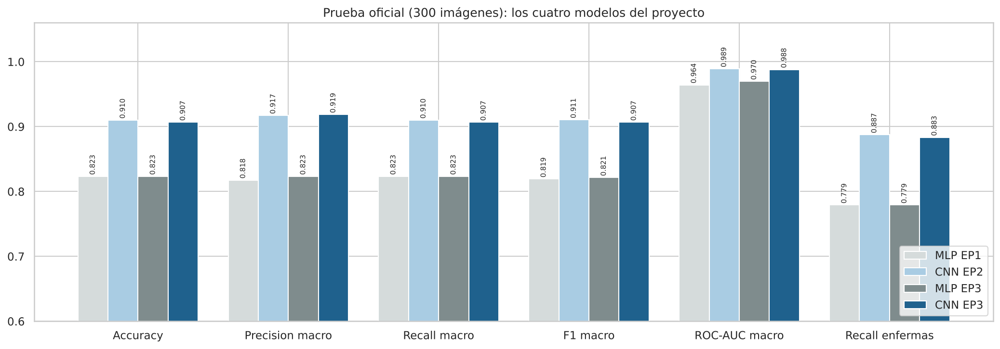
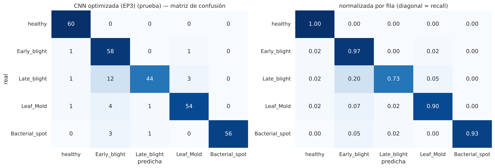
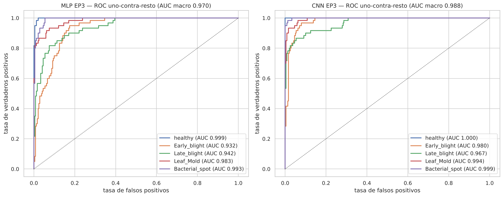

- **La CNN supera al MLP** por 8,3 pp. En las 41 imágenes donde discrepan, la CNN acierta 33 y el MLP 8 (McNemar p = 0,0001).
- **Reentrenar las mismas configuraciones reproduce los resultados.** El MLP EP3 da exactamente el mismo accuracy que el de la EP1, y la CNN EP3 queda a 1 imagen de la EP2 (McNemar p = 1,0 en ambos casos).
- **Con otras semillas**, el F1 de la CNN va de 0,877 a 0,907 (media 0,895 ± 0,015). Con 300 imágenes, 3 pp entre dos entrenamientos de la misma red es normal, así que no tomamos ningún número de una sola ejecución como definitivo.
- La CNN concentra casi todos sus errores en **Late_blight → Early_blight**, igual que en la EP2.

### 10.2 Prueba ampliada (5.350 imágenes que ningún modelo vio)

| Métrica | MLP EP1 | CNN EP2 | MLP EP3 | CNN EP3 |
|---|---|---|---|---|
| Accuracy (IC 95 %) | 0,851 [0,841; 0,860] | 0,932 [0,925; 0,939] | 0,855 [0,845; 0,864] | 0,926 [0,919; 0,933] |
| F1 macro | 0,823 | 0,919 | 0,831 | 0,914 |
| ROC-AUC macro | 0,976 | 0,994 | 0,979 | 0,994 |
| % enfermas → sana | 2,26 % | 0,66 % | 2,21 % | **0,49 %** |
| ECE | 0,018 | 0,007 | 0,031 | 0,022 |

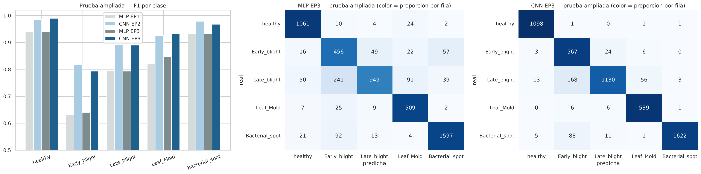

La prueba ampliada confirma todo con intervalos mucho más estrechos. En las 632
imágenes donde discrepan, la CNN acierta 508 y el MLP 124 (p ≈ 10⁻⁵⁶). La CNN deja
sin detectar solo el 0,49 % de las hojas enfermas (21 de 4.249). La clase de menor
F1 es Early_blight (0,79), pero no por sus propias imágenes (recall 0,945), sino
porque recibe los errores de otras: 168 Late_blight y 88 Bacterial_spot terminan
clasificadas como Early_blight.

## 11. Auditoría del modelo

### 11.1 Grad-CAM: dónde mira la CNN

Esta vez no nos quedamos con la impresión visual: medimos qué porcentaje de la
activación de Grad-CAM cae **sobre la hoja**, usando una máscara de la hoja hecha
por color (la hoja ocupa en promedio el 38 % de la imagen).

| Clase | CNN EP2 | CNN EP3 | Lectura |
|---|---|---|---|
| healthy | 55 % | 58 % | Mira la hoja completa |
| Early_blight | 53 % | 55 % | Sobre todo la hoja y las lesiones |
| Late_blight | 38 % | 38 % | Atención uniforme: hoja y fondo por igual |
| **Leaf_Mold** | **8 %** | **10 %** | **Mira el fondo** |
| Bacterial_spot | 70 % | 72 % | El interior de la hoja, donde están los puntos |

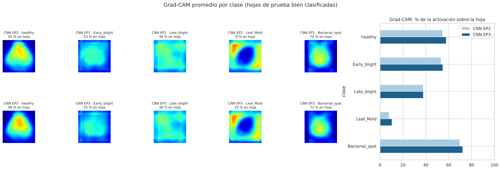

El atajo de Leaf_Mold que vimos en la EP2 se confirma, y es más fuerte de lo que
pensábamos: solo el 10 % de la evidencia está sobre la hoja.

### 11.2 LIME: la misma herramienta para los dos modelos

Grad-CAM no funciona con el MLP, porque no tiene convoluciones. LIME sí, porque
solo necesita las predicciones. Explicamos las mismas 30 imágenes con ambos
modelos.

| | MLP EP3 | CNN EP3 |
|---|---|---|
| % de la evidencia LIME sobre la hoja (promedio) | 34 % | 40 % |
| Leaf_Mold | 23 % | 29 % |
| Early_blight | 13 % | 17 % |
| R² del modelo local de LIME | 0,49 | 0,34 |

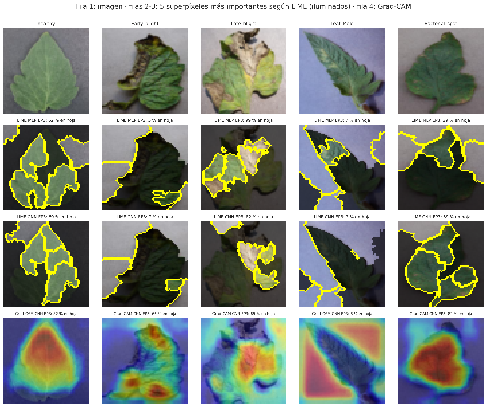

- **El atajo de Leaf_Mold no es propio de la CNN, es del dataset:** el MLP también usa el fondo.
- **En Early_blight, LIME y Grad-CAM no coinciden**, y entender por qué fue útil. LIME "apaga" partes de la imagen pintándolas de negro, y un fondo negro es justamente la firma de las fotos de invernadero de Late_blight. Al ennegrecer el fondo claro de una Early_blight, la imagen se parece a una Late_blight y la probabilidad cae, así que LIME concluye que el fondo era importante. Es un límite de LIME, y a la vez otra señal de que el color del fondo está asociado a la clase.
- La CNN tiene una ventaja de explicabilidad: Grad-CAM es más fino y mucho más barato que LIME (un gradiente frente a 500 predicciones por imagen).

### 11.3 Sesgos: rendimiento por sesión de captura

| Clase · sesión | n (ampliada) | MLP EP3 | CNN EP3 |
|---|---|---|---|
| Late_blight · `GHLB*` (invernadero) | 651 | 0,89 | 0,98 |
| **Late_blight · `RS_Late.B`** | 719 | **0,51** | **0,68** |
| Bacterial_spot · `GCREC` | 1.432 | 0,93 | 0,95 |
| Bacterial_spot · `UF.GRC` | 295 | 0,88 | 0,91 |
| healthy · `GH_HL` / `RS_HL` | 350 / 750 | 0,99 / 0,95 | 0,99 / 1,00 |
| **Mayor diferencia entre sesiones (KPI ≤ 0,15)** | | **0,38** | **0,30** |

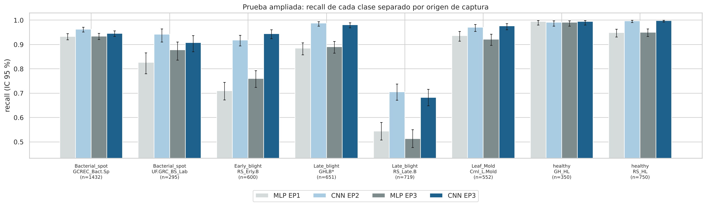

**Ningún modelo cumple el KPI de sesgo.** El 93 % global esconde un subgrupo
concreto, el tizón tardío fotografiado en la sesión RS, donde **uno de cada tres
casos no se detecta**. Esas hojas comparten fondo y luz con las Early_blight (que
también son de la sesión RS). Sin la ayuda del fondo, la red tiene que distinguir
dos tizones de color parecido por la forma de la lesión, y a 64 × 64 no le
alcanza. Es justamente la enfermedad que más rápido destruye un cultivo.

### 11.4 Prueba causal: cambiar solo el fondo

Para pasar de la correlación a la causalidad, reemplazamos el fondo de cada imagen
de la prueba ampliada por un gris neutro y dejamos la hoja intacta. Si el modelo
mirara solo la hoja, no debería cambiar nada.

| Clase | Cambio de recall de la CNN EP3 | MLP EP3 |
|---|---|---|
| healthy | −8 pp | −3 pp |
| Early_blight | −11 pp | −31 pp |
| Late_blight | −32 pp | −28 pp |
| **Leaf_Mold** | **−55 pp** | −36 pp |
| Bacterial_spot | −43 pp | −8 pp |
| F1 macro | −30 pp | −21 pp |

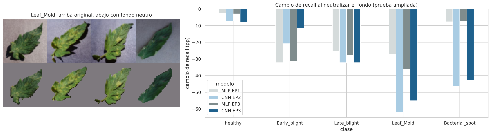

Sin su fondo azulado, **más de la mitad de las Leaf_Mold dejan de reconocerse**.
Grad-CAM (correlación) y la intervención (causalidad) dicen lo mismo. Hay que
considerar que una imagen con fondo gris plano es algo artificial, pero healthy
casi no cambia (−8 pp) y la caída se concentra en las clases cuyo fondo era
distintivo, así que lo interpretamos como un atajo y no como un efecto de la
manipulación.

### 11.5 Robustez y el trade-off del aumento de color

| Perturbación (prueba ampliada) | MLP EP3 | CNN EP3 |
|---|---|---|
| original | 0,831 | 0,914 |
| más oscura | 0,577 | 0,737 |
| más clara | 0,628 | 0,567 |
| ruido gaussiano (σ = 0,05) | **0,830** | **0,420** |
| desenfoque | 0,831 | 0,793 |
| tinte frío (balance de blancos ±10 %) | 0,485 | 0,437 |
| fondo neutro | 0,625 | 0,617 |
| **Caída media de F1** | **16 pp** | **31 pp** |

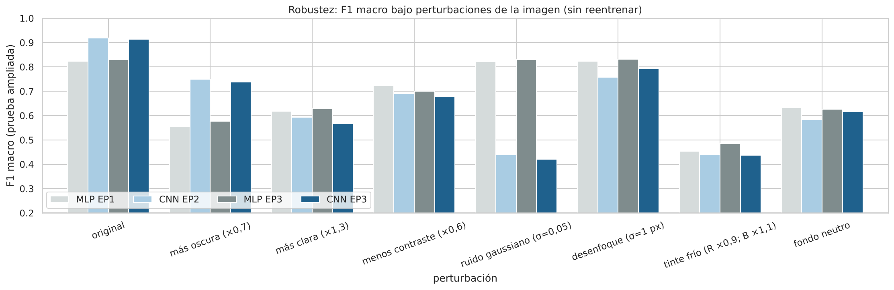

La CNN es más precisa, pero **bastante más frágil**. Con un ruido casi invisible
cae a 0,42 y casi nunca dice Bacterial_spot (sus filtros dependen de la textura
fina de los puntitos). El MLP no se inmuta, porque decide sobre todo por el color
global, que es también la razón de que sea menos preciso. **Ambos colapsan con un
cambio de balance de blancos del 10 %**: con la imagen un poco más azul, la CNN
llama Leaf_Mold al 47 % de las hojas. "Azulado" significa Leaf_Mold para la red.

Como habíamos guardado los pesos de todos los experimentos, pudimos comparar sin
reentrenar los modelos que solo difieren en el aumento de datos:

| CNN | F1 validación | F1 ampliada | F1 fondo neutro | F1 tinte frío | Diferencia entre sesiones |
|---|---|---|---|---|---|
| aumento `geom` (elegida) | **0,910** | **0,914** | 0,617 | 0,437 | **0,30** |
| aumento `geom+color` | 0,868 | 0,860 | **0,767** | **0,795** | 0,50 |

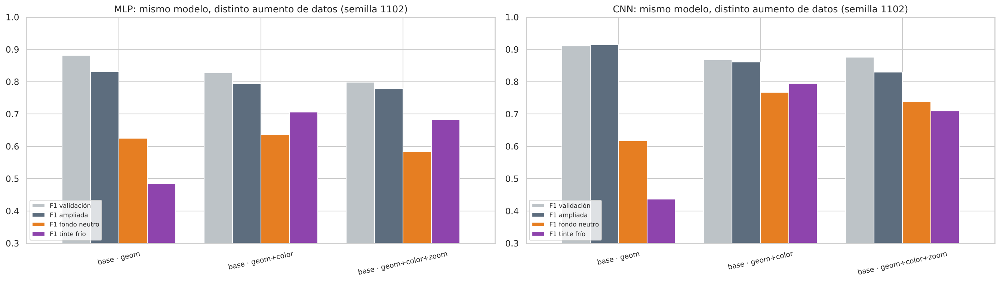

El aumento de color **sí corrige el atajo**: con fondo neutro pierde 9 pp en vez de
30 y con tinte frío se mantiene en 0,80 en vez de caer a 0,44. Pero pierde 5 pp en
los datos originales, y por eso la regla de selección, que solo mira la
validación, lo descartó. **La validación tiene el mismo sesgo que el entrenamiento,
así que premia al modelo que usa el atajo.**

Encima, el sesgo entre sesiones empeora (0,30 → 0,50). Las Late_blight de la
sesión RS bajan de 68 % a 47 %, porque lo único que las separaba de las
Early_blight con el mismo fondo era el **color de la lesión**, y el aumento de
color también altera esa señal legítima. La conclusión es concreta: no hay que
variar el color de **toda** la imagen, sino **solo el fondo** (segmentar la hoja y
cambiarle el fondo al azar al entrenar).

### 11.6 Errores de la CNN

La CNN EP3 se equivoca en 28 de 300 imágenes. 15 de esos errores son Late_blight
de la sesión RS (12 de ellos clasificados como Early_blight), y 7 errores tienen
confianza ≥ 0,90. En los errores Late_blight → Early_blight, el Grad-CAM de la
clase real **se enciende en las esquinas del fondo**. Para la red, la evidencia de
"Late_blight" es en parte el fondo oscuro del invernadero, y cuando la foto viene
con el fondo claro de la sesión RS, esa evidencia no aparece.

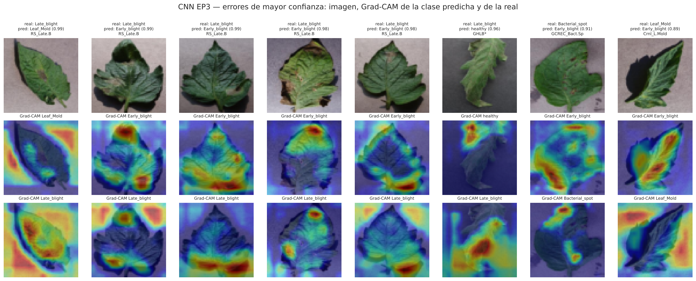

## 12. MLP vs CNN y modelo recomendado

| Criterio | MLP optimizado | CNN optimizada |
|---|---|---|
| F1 macro (oficial / ampliada) | 0,821 / 0,831 | **0,907 / 0,914** |
| Enfermas → sana (ampliada) | 2,2 % | **0,5 %** |
| Brecha de generalización | 0,155 | **0,072** |
| Estabilidad entre semillas (desv. F1) | 0,017 | **0,003** |
| Calibración (ECE, ampliada) | 0,031 | **0,022** |
| Explicabilidad | solo LIME | **Grad-CAM + LIME** |
| Robustez (caída media ante perturbaciones) | **16 pp** | 31 pp |
| Sesgo entre sesiones | 0,38 | **0,30** (ambos fallan) |
| Parámetros | 3,18 M | **1,14 M** |
| Tiempo de entrenamiento (CPU) | **76 s** | 214 s |
| KPIs cumplidos | 1 de 7 | **4 de 7** |

**Recomendamos la CNN** (la configuración de la EP2, confirmada por la
optimización):

- Es mejor en desempeño en las cinco clases y en las dos pruebas, con diferencias significativas.
- Deja sin detectar 4,5 veces menos hojas enfermas.
- Generaliza mejor y es más estable entre semillas.
- Permite auditarla con Grad-CAM, que fue lo que reveló el atajo.
- Usa un tercio de los parámetros.

La recomendación tiene condiciones. La CNN es más frágil que el MLP ante
perturbaciones, y ninguno de los dos cumple el KPI de sesgo. Por eso la
recomendamos **como herramienta de apoyo en condiciones parecidas a las de
PlantVillage** (hoja aislada, fondo uniforme), **con derivación al agrónomo de los
casos de baja confianza**, y **no la recomendamos para fotos de campo** hasta
aplicar las mejoras de la sección 13.

| KPI | Meta | CNN EP3 | ¿Cumple? |
|---|---|---|---|
| F1 macro, prueba oficial | ≥ 0,91 | 0,907 | No (a 1 imagen) |
| F1 macro, prueba ampliada | ≥ 0,90 | 0,914 | Sí |
| Recall de enfermas, prueba oficial | ≥ 0,90 | 0,883 (0,921 en la ampliada) | No |
| % enfermas → sana, ampliada | ≤ 1 % | 0,49 % | Sí |
| Brecha de generalización | ≤ 0,10 | 0,072 | Sí |
| Desv. estándar entre semillas | ≤ 0,02 | 0,003 | Sí |
| Diferencia de recall entre sesiones | ≤ 0,15 | 0,30 | **No** |

## 13. Evaluación crítica del pipeline

**Fortalezas.** El pipeline es modular (una función por etapa, el mismo código para
MLP y CNN), trazable (reproduce la EP1 y la EP2) y reproducible (semilla,
operaciones deterministas y caché: la segunda ejecución dio exactamente los mismos
números). Además, toma las decisiones sin tocar la prueba y con una regla fijada de
antemano, y resiste el azar gracias a la confirmación con 3 semillas, que evitó
adoptar una mejora falsa. Su auditoría va más allá del accuracy, y por eso
encontró un sesgo que las métricas globales no mostraban.

**Limitaciones.**

1. **La validación tiene el mismo sesgo que el entrenamiento.** Es la principal. El pipeline optimiza bien lo que mide, pero lo que mide (accuracy en las mismas sesiones) no es lo que importa en campo. Por eso descartó el aumento que reducía el atajo.
2. La partición se hace por imagen y no por hoja (7 imágenes de prueba tienen su hoja en entrenamiento).
3. La búsqueda estuvo limitada por el cómputo (63 experimentos en 2 h 42 min sin GPU), y OFAT supone que los efectos se suman, lo que el Random Search mostró que no siempre ocurre.
4. La resolución quedó fija en 64 × 64 para mantener la comparación con la EP1, y probablemente es lo que impide separar los tizones.
5. Las herramientas de auditoría son aproximadas: la máscara de la hoja es una heurística de color, LIME depende del color de reemplazo y el fondo neutro genera imágenes artificiales.
6. Usamos un solo dataset, sin fotos de campo.

**Riesgos.** Usar el modelo tal como está daría una falsa confianza. Con
PlantVillage, Mohanty et al. (2016) vieron caer el accuracy de 99 % a 31 % al
probar con imágenes de otras fuentes. También daría un servicio peor a un subgrupo
concreto (tizón tardío tipo RS) y dejaría errores con confianza alta que un umbral
no atraparía.

**Mejoras para la próxima versión** (en orden de prioridad):

1. Validar por sesión de captura (*leave-one-session-out*) y particionar por hoja.
2. Usar un criterio de selección que sume robustez y sesgo al F1.
3. Aleatorizar **solo el fondo** usando la máscara de la hoja, y agregar aumento con ruido y desenfoque.
4. Probar *transfer learning* (MobileNetV2 o EfficientNet-B0) a 128–224 px.
5. Hacer una búsqueda bayesiana (Optuna) en GPU.
6. Validar con fotos de campo (por ejemplo, PlantDoc) y calibrar con *temperature scaling*.

## 14. Conclusiones

1. **Construimos un pipeline integrado** que entrena, regulariza, optimiza y audita el MLP y la CNN bajo condiciones idénticas y de forma reproducible.
2. **La regularización es decisiva para el MLP (+9,7 pp) y secundaria para la CNN (+1,3 pp)**, cuya arquitectura ya regulariza. En el MLP lo más importante es el aumento de datos; en la CNN, el Dropout.
3. **La optimización confirmó las configuraciones anteriores.** Después de 63 experimentos, ninguna configuración superó con claridad a la de la EP1 o la EP2. La aparente mejora de L2 era efecto de la semilla, y la confirmación con 3 semillas lo detectó.
4. **La CNN es el mejor modelo:** F1 0,914 frente a 0,831 en 5.350 imágenes nuevas, con 4,5 veces menos enfermas sin detectar, mejor generalización y mejor explicabilidad. A cambio, es más frágil ante perturbaciones.
5. **El hallazgo más importante estaba en los datos.** En PlantVillage cada clase viene de sus propias sesiones de captura, y los modelos aprenden en parte la sesión y no solo la enfermedad. Este sesgo de captura explica la confusión entre tizones que arrastrábamos desde la EP1. Lo confirmamos de cuatro formas: Grad-CAM, rendimiento por subgrupo, intervención del fondo y perturbaciones de color.
6. **Para corregirlo hay que cambiar lo que se mide.** Con una validación que comparte el sesgo, cualquier optimización termina premiando el atajo. La próxima iteración debe validar por sesión y aleatorizar solo el fondo.

## 15. Cómo reproducir el trabajo

Ver el [README](README.md). El notebook se ejecuta de principio a fin sin errores.
Con `REUTILIZAR_RESULTADOS = True` lee los 63 experimentos guardados en
`models/ep3_experimentos/` y corre en pocos minutos. Con `False` reentrena todo
(2 h 42 min en una CPU de 2 núcleos; bastante menos en Colab con GPU).

## Referencias

- Hughes, D. P. & Salathé, M. (2015). *An open access repository of images on plant health to enable the development of mobile disease diagnostics*. arXiv:1511.08060.
- Mohanty, S. P., Hughes, D. P. & Salathé, M. (2016). Using deep learning for image-based plant disease detection. *Frontiers in Plant Science*, 7, 1419.
- Noyan, M. A. (2022). *Uncovering bias in the PlantVillage dataset*. arXiv:2206.04374.
- Selvaraju, R. R. et al. (2017). Grad-CAM: Visual explanations from deep networks via gradient-based localization. *ICCV*.
- Ribeiro, M. T., Singh, S. & Guestrin, C. (2016). "Why should I trust you?": Explaining the predictions of any classifier. *KDD*.
- Srivastava, N. et al. (2014). Dropout: A simple way to prevent neural networks from overfitting. *JMLR*, 15.
- Ioffe, S. & Szegedy, C. (2015). Batch normalization. *ICML*.
- Bergstra, J. & Bengio, Y. (2012). Random search for hyper-parameter optimization. *JMLR*, 13.
- Guo, C. et al. (2017). On calibration of modern neural networks. *ICML*.
- Müller, R., Kornblith, S. & Hinton, G. (2019). When does label smoothing help? *NeurIPS*.
